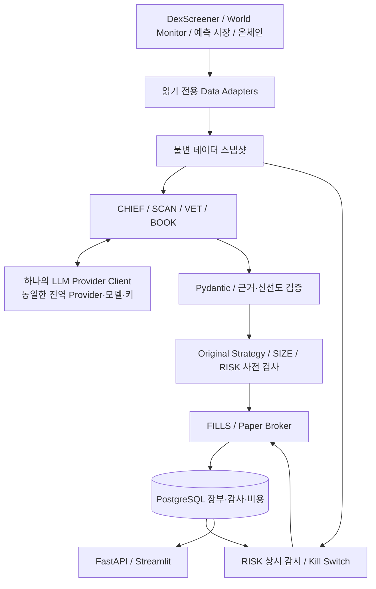

# 아키텍처

구현 업데이트: 이 문서는 Phase 1의 설계 기록입니다. 승인 후 FastAPI·SQLAlchemy·APScheduler·Streamlit·모의 Broker를 구현했습니다.
현재 실행 명령과 실제 제한은 [README](../README.md), [구현 해석](implementation-decisions.md), [검증 보고서](validation-report.md)를 확인하세요.

상태: Phase 1 설계. 애플리케이션·DB·스케줄러는 아직 구현하지 않았습니다.

## 1. 시스템 경계

Python 3.12+, FastAPI, Pydantic, PostgreSQL, SQLAlchemy, APScheduler, Streamlit을 사용하는 모듈형 단일 저장소를 계획합니다.
API, 스케줄러 worker, 대시보드는 프로세스를 분리하고 PostgreSQL을 상태의 기준으로 둡니다.
Docker Compose 구성은 Phase 2 이후 추가합니다. 이번 단계에서 서비스를 실행했다고 주장하지 않습니다.

도표의 RISK→FILLS는 가상 청산 의도입니다. 유효한 가격이 없으면 의도를 보존하고 실제 가상 체결은 기다립니다. 외부 시장에 주문을 보내는 경로는 없습니다.

## 2. 7개 역할과 공용 모델

논리적 에이전트 7개를 유지하되 LLM을 쓰는 역할은 CHIEF·SCAN·VET·BOOK입니다.
이 4개 역할은 하나의 클라이언트와 동일 설정을 공유하며, 역할별로 프롬프트·스키마·허용 데이터 범위만 다릅니다.
SIZE·FILLS·RISK는 모델이 없는 Python 서비스입니다. CHIEF의 일정 실행·실패 감지 역시 Python이 담당합니다.

SCAN 후보 선택의 하드 필터, VET 하드 거절, BOOK 가격 차이와 진입 여부는 규칙 엔진에서 다시 확인합니다.
LLM이 제시한 주문 수량·체결 가격·위험 한도는 권한 있는 입력으로 받지 않습니다.

## 3. 사이클 처리

1. Python CHIEF runner가 DB lease/advisory lock을 얻어 단일 사이클을 생성합니다. APScheduler 중복 프로세스 실행을 차단합니다.
2. 해당 사이클에 전역 모델 설정, 프롬프트·스키마·전략·데이터 정책 버전, 초기 장부 상태를 고정합니다.
3. 독립 RISK 루프는 5분마다 기존 포지션과 Kill Switch를 점검합니다. SCAN은 15분마다 실행하며 신규 LLM 응답을 기다리느라 RISK를 늦추지 않습니다.
4. Adapter가 필요한 데이터를 수집하고 원본 응답·출처·시각·해시·누락 상태를 저장합니다. 필수 입력이 부족하면 신규 거래를 차단합니다.
5. SCAN→VET 및 BOOK 분석은 같은 전역 모델로 수행합니다. 서로 다른 전략 경로의 후보를 섞어 Kelly 입력을 만들지 않습니다.
6. Pydantic과 근거 검증 후 원문 정책이 후보를 판정합니다. 원문에서 수식·실행 의미가 미정의된 부분을 확정하지 못했으면 해당 거래를 차단합니다.
7. SIZE가 검증된 확률·배당·비용·잔고·한도를 사용해 수량을 계산합니다. RISK가 노출·잔고·Kill Switch를 다시 검사합니다.
8. FILLS가 저장된 시장 스냅샷과 체결 정책으로 가상 체결을 계산하고 한 DB 트랜잭션에 체결·장부·포지션·감사를 반영합니다.
9. CHIEF는 사실 기록을 바탕으로 보고서를 작성합니다. 보고 실패가 이미 확정한 체결을 재실행시키지 않습니다.

원문 주기는 SCAN 15분, RISK 5분, 마감 보고 23:00 Asia/Seoul입니다.
CHIEF는 2회 무응답 후 1회 재시작하고 같은 봇이 1시간에 2회 죽으면 데스크를 중단·보고하되 직접 청산하지 않습니다.
밈코인과 BOOK 경로를 분리하며, SIZE 이전의 VET 금액 검증 같은 모호함은 [원문 명세](original-strategy-spec.md)의 OPEN 항목으로 관리합니다.

## 4. 공통 메시지와 영속 데이터

에이전트 메시지의 예정 필드는 `message_id`, `cycle_id`, `role`, `schema_version`, `snapshot_ids`, `created_at`,
`config_revision`, `decision_status`, `payload`, `evidence_refs`, `error_code`입니다.
LLM 응답 봉투에는 Provider·모델, 요청 ID, 응답 지연, 사용량, 비용 추정 여부, 원문 응답 해시를 별도로 기록합니다.
키·인증 헤더는 어떤 메시지에도 넣지 않습니다.

| 저장 단위 | 핵심 불변조건 |
| --- | --- |
| data_snapshots | 원본 bytes/JSON, source URI/ID, observed_at(없으면 null), fetched_at, stale/coverage, SHA-256; 수정 대신 새 버전 |
| cycles / config_revisions | 동일 사이클의 Provider·모델·전략 버전 고정; 키 자체는 저장하지 않음 |
| agent_messages / decisions | 스키마 검증 결과와 거절 이유 보존; LLM 의견과 최종 규칙 결정 분리 |
| paper_orders / paper_fills | 사이클·후보·방향·주문 의도 기준 고유키; 동일 요청 재시도 시 기존 결과 반환 |
| ledger_entries / positions | Decimal/최소단위, 현금 예약, 거래 비용, 실현·미실현 손익; 원자적 갱신 |
| risk_state / audit_events | Kill Switch·정책 변경·실패·청산 요청의 행위자와 이유 기록 |
| model_usage / evaluation_runs | 실패 요청도 기록; 실제 사용량과 추정 사용량 구별 |

실행 중 장부 행을 잠그고 가용 잔고·예약금·노출을 다시 읽습니다. 모델 분석 중의 잔고로 체결을 확정하지 않습니다.
프로세스가 체결 후 응답 전에 죽어도 고유 주문/체결 키와 트랜잭션 덕분에 재시도가 두 번째 체결을 만들지 않아야 합니다.

## 5. 결정론적 모의매매

FILLS는 유효한 체결 정책, 호가/풀 상태 또는 문서화된 실행 가능성 자료가 있을 때만 체결합니다.
마지막 표시가격과 24시간 거래량만으로 즉시 전량 체결을 가정하지 않습니다.

- 스냅샷에 관측된 유동성에 따라 체결·부분 체결·미체결을 구분합니다.
- 원문 수수료 0.45%·최소 0.95달러, 슬리피지 2%를 보존합니다. 부분 체결별 수수료·정밀도·잔여 주문 유효기간은 별도 체결 정책으로 명시합니다.
- 금액은 Decimal, 자산 수량은 자산의 최소 단위로 처리합니다. rounding mode를 저장합니다.
- 결정론적 결과에는 snapshot ID, 규칙 버전, 입력 장부, 계산 시각, 이벤트 순서가 모두 포함됩니다.
- 뉴스·스냅샷을 나중에 보완해 과거 사이클에 끼워 넣지 않습니다. 백테스트는 당시 이용 가능했던 자료만 사용합니다.

## 6. RISK와 PAPER ONLY

`TRADING_MODE`는 `paper` 리터럴만 허용합니다. 실거래 enum 값, broker 구현체, 서명·자금 전송·주문 제출 endpoint를 두지 않습니다.
예측 시장 SDK의 주문·지갑 기능도 Adapter에 노출하지 않습니다. 외부 API는 검증된 데이터 읽기 작업만 허용합니다.
모델 추론과 읽기 전용 MCP는 POST를 쓸 수 있으므로 HTTP 메서드만으로 허용 여부를 결정하지 않습니다.

Kill Switch는 즉시 신규 주문과 남은 가상 진입 주문을 차단·취소하고 상태를 영속화합니다.
RISK는 원문의 거래량 비율 <0.20 또는 2회 재시도 후에도 무응답이면 전량 청산 의도를 만듭니다.
데이터 장애로 가격을 알 수 없으면 청산 결정을 무시하지 않고 `CLOSE_REQUESTED_UNPRICED`로 보존합니다. FILLS는 가격을 만들어 체결하지 않고 포지션·평가손익을 `unpriced`로 표시합니다.
전체 equity나 수익률도 관측 가능한 부분과 미평가 부분을 구별합니다.

## 7. 장애 처리

| 상황 | 신규 거래 | 기존 포지션·복구 |
| --- | --- | --- |
| 원문에 수식·실행 의미 미정의 | 해당 거래 차단 | 승인된 정책 해석 전 Original Strategy 미활성 |
| LLM timeout·거절·스키마 오류 | 해당 신호/사이클 차단 | Python RISK 루프는 계속 실행 |
| 데이터 결측·stale·출처 불명 | 해당 자산/신호 차단 | RISK 청산 의도와 실제 가상 체결을 구별 |
| 로컬 World Monitor degraded | BOOK 정지, 필수 검증 가능한 밈코인만 계속 | hosted REST/MCP로 자동 대체하지 않음 |
| DB/감사 쓰기 실패 | 체결 트랜잭션 rollback 및 신규 처리 중지 | DB 복구 후 고유키로 재개 |
| worker 재시작 | lease·미완료 작업 복구 후 신규 사이클 | 고정 설정을 검증할 수 없는 사이클은 중단 |
| 단일 모델 설정 변경 | 검증 완료 후 새 사이클부터 | 진행 중 사이클은 기존 설정 유지 |

## 8. 대시보드와 추후 검증

Trading Overview, Agent Status, World Monitor Events, Meme Coin Scanner, Prediction Opportunities, Open Positions,
Trade History, Performance Analytics, Global Model Configuration, Model Comparison, API Cost, Risk Monitor를 계획합니다.
모델 설정 화면에는 전역 Provider·모델·검증 상태·키 존재 여부만 보여줍니다. 에이전트별 모델 선택 UI는 제공하지 않습니다.

단위·통합·재생 검증의 단계별 통과 조건은 [로드맵](development-roadmap.md)을 따릅니다.
현재 검증한 것은 [보고서](validation-report.md)의 외부 SDK 오프라인 계약과 문서 검사뿐입니다.
